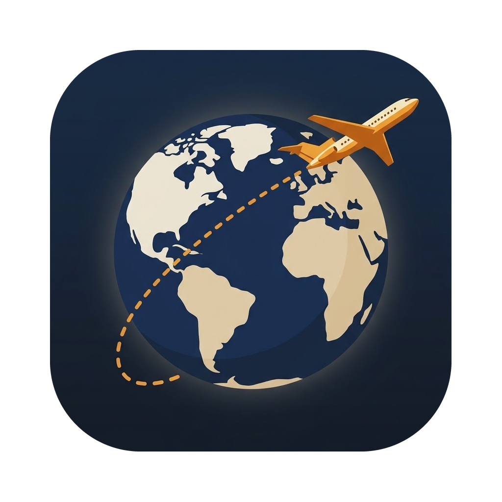

<h1 align="center">AIrways</h1>

An airline management game for macOS · build an airline from 1950 to today

---

This repository only hosts **builds for testers**. The source code is private.

## Download

Get the latest `.dmg` from **[Releases](../../releases/latest)**.

1. Open the downloaded `AIrways-<version>.dmg`.
2. Drag **AIrways** into **Applications**.
3. Open it from Applications. The app is signed and notarized by Apple, so it opens without security warnings.

**Requirements:** macOS 14 (Sonoma) or later · Apple Silicon or Intel.

## What to expect

- Real-time airline management on a NASA satellite map that changes with the seasons.
- Routes, schedules, slots, fleet, cabins, service, marketing, partnerships and subsidiaries.
- A board of directors with monthly proposals and an annual target; miss two and you're fired.
- Rival airlines with their own personalities. Optionally, in Professional mode, rivals can plan their strategy with an Anthropic Claude model using **your own API key** (stored only in your Mac's Keychain; billed to your account; can be switched off at any time).

## Feedback

Please report bugs and ideas in **[Issues](../../issues)**. Helpful details:

- what you did, what you expected and what happened;
- the game date and speed;
- a screenshot, and the save file if you can (menu ··· → Save…).

## Notes for testers

- If you saved a game in an older build, it may not open in a newer one.
- On first use of AI rivals, macOS may ask for your password to let AIrways read its own Keychain item; choose **Always Allow**.

## Credits

Original soundtrack by Stefano Garzon. Satellite imagery: NASA Earth Observatory, Blue Marble Next Generation (Reto Stöckli), public domain. Data: OurAirports and Natural Earth (public domain); GeoNames, Maddison Project Database and Our World in Data (CC BY 4.0). Full credits in the app under **About AIrways**.

All airlines, aircraft and people in the game are fictional.

© 2026 Stefano Garzon. All rights reserved. Free to play for invited testers; please don't redistribute the build.
